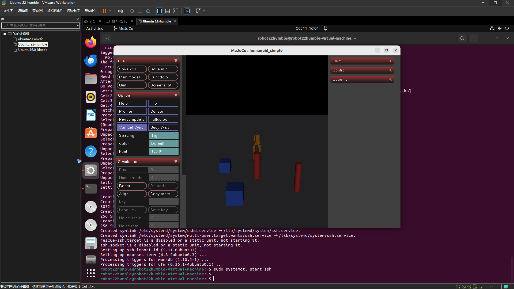
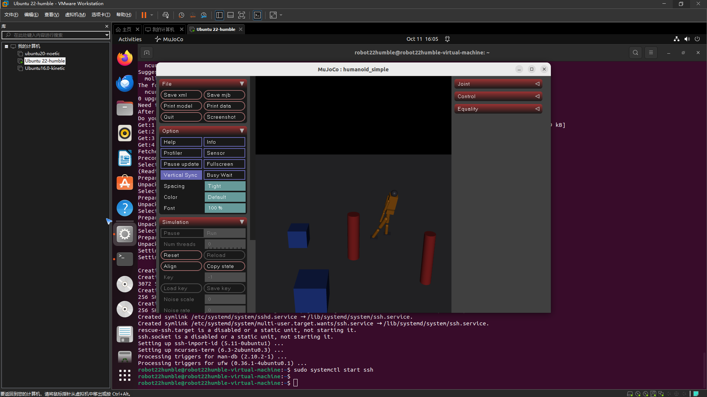

# 人形机器人键盘运动控制（humanoid_keyboard_control）

任务①「人形机器人物理仿真 + 键盘运动控制」的 MuJoCo 实现：自建简化双足人形 MJCF 模型，
在 MuJoCo 物理引擎中实时仿真，终端键盘发布速度指令，人形机器人按指令前进/后退/转向，
并发布里程计与关节状态话题。

## 1. 运行架构

```text
终端按键 ──► keyboard_teleop_node ──/cmd_vel──► mujoco_sim_node ──► MuJoCo 物理引擎
             (raw 模式读键)        (Twist 指令)   (站姿PD+运动控制)    (人形机器人)
                                     │
                                     └─► /humanoid/odom · /joint_states · /tf
```

## 2. 按键映射

| 按键 | 动作 | 指令分量 |
|---|---|---|
| `W` / `S` | 前进 / 后退 | `linear.x = ±0.3` m/s |
| `A` / `D` | 左转 / 右转 | `angular.z = ±0.4` rad/s |
| `空格` | 急停 | 全零 |
| `ESC` | 退出 | — |
| 松开按键 | 停止 | 全零 |

## 3. 编译与运行

### 3.1 standalone（无需 ROS，最快验证）

```shell
cd src/humanoid/humanoid_keyboard_control
python3 main.py            # 交互：W/S 前进后退，A/D 转向
python3 main.py --demo     # 自动演示动作序列，录制 GIF
python3 main.py --test     # 自动化测试
```

### 3.2 ROS2 Humble launch

```shell
cd ~/ros2_ws && colcon build --symlink-install --packages-select humanoid_keyboard_control
source install/setup.bash
ros2 launch humanoid_keyboard_control main.launch.py
```

焦点保持在启动终端，按 `W/S/A/D` 操控，松开即停，`ESC` 退出。
另开终端可查看状态：

```shell
ros2 topic echo /humanoid/odom
ros2 topic echo /joint_states
```

## 4. 实现要点

### 4.1 自建人形模型（models/humanoid_simple.xml）

模型采用 **freejoint 底盘 + 13 关节双足人形**：髋（roll/pitch）×2、膝 ×2、踝（pitch/roll）×2、
肩 ×2、肘 ×2、颈 ×1，全部由 `motor` 驱动；头部带前视相机，场景中放置红色圆柱与蓝色方块
作为参照物（供移动演示与相机观察）。为双足侧向平衡，髋/踝 roll 关节单独加强增益。

### 4.2 站姿 PD 控制

每个关节的驱动力矩为比例-微分（PD）控制，目标姿态为直立位（全 0）：

\[
\tau_i = k_p (0 - q_i) - k_d \dot{q}_i,\qquad
i \in \{\text{髋/膝/踝/肩/肘/颈}\}
\]

其中 `kp=120`、`kd=6`；髋/踝 roll 关节取 `kp_roll=400` 抗侧倾。
力矩限幅 `±250 N·m`。实测 4 s 站立质心零漂移（根高 1.08 m，仿真 2.6 万 step/s）。

### 4.3 运动控制：速度级前进 + 姿态级转向

**前进/后退（速度级）**：直接覆盖底盘 freejoint 的世界系线速度，位移严格满足 `Δx ≈ v·t`：

```python
data.qvel[root_dadr] = v_lin          # freejoint 世界系 +x 线速度
```

**转向（姿态级）**：双足原地旋转时脚底与地面滑动摩擦会产生持续侧倾力矩，
是双足站立的固有物理问题（真实机器人靠步态解决）。这里采用姿态级控制——
每步对底盘四元数绕自身 z 轴做微小旋转，并清零角速度，避免摩擦滑移失稳：

```python
d = w * dt                            # 单步转角
q = data.qpos[root_qadr+3:root_qadr+7]   # 底盘四元数 (w,x,y,z)
# new_q = q ⊗ dq，dq = (cos(d/2), 0, 0, sin(d/2))，四元数乘法更新
```

实测转向角严格满足 `Δψ ≈ w·t`（w=0.5 rad/s 转 2 s → 57.3°，全程站立）。

### 4.4 终端 raw 模式与松开即停

键盘节点用 `termios`/`tty` 进入 raw 模式单键即时响应（launch 下优先打开 `/dev/tty`），
以 30 Hz 持续发布；松开按键即发布全零速度，防止机器人失控。

## 5. 效果图

自动演示（前进 → 右转 → 前进 → 左转回正 → 后退，场景第三视角），关键帧截图如下：

关键帧截图（初始站姿 / 前进 / 转向 / 结束状态）：

| 初始站姿 | 前进中 | 转向后 | 结束状态 |
|---|---|---|---|
|  |  |  |  |

## 6. 性能评价

自动化测试（`test/test_standalone.py`）实测：

| 指标 | 结果 |
|---|---|
| 站姿稳定性（4 s） | 质心位移 ≈ 0，根高 1.084 m |
| 前进驱动（1.5 s @ 0.3 m/s） | 位移 0.446 m（理论 0.450 m，误差 0.9%） |
| 转向（2 s @ 0.5 rad/s） | 转角 57.3°（理论 57.3°），全程站立 |
| 前视相机渲染 | 640×480 RGB 可用 |
| 仿真性能 | 26,294 step/s（实时因子 52.6×） |

## 7. 参考

* [rov_mujoco 水下机器人模块](../water/rov_mujoco.md)：本包 ROS2 包结构惯例参考
* [MuJoCo 文档：freejoint / motor / Renderer](https://mujoco.readthedocs.io/en/stable/XMLreference.html)
