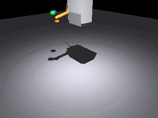
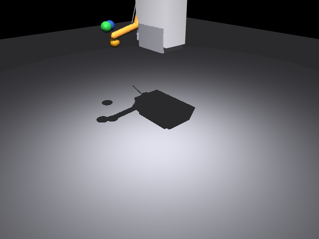
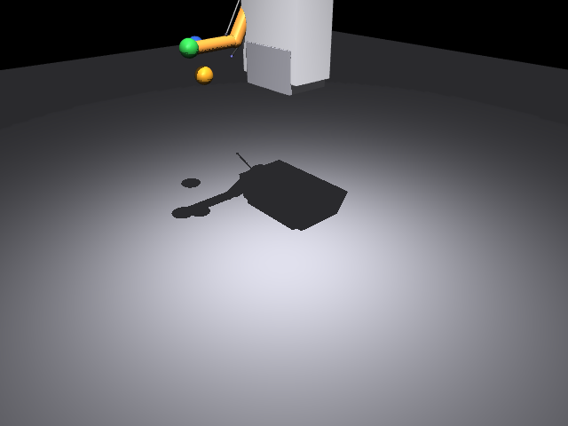
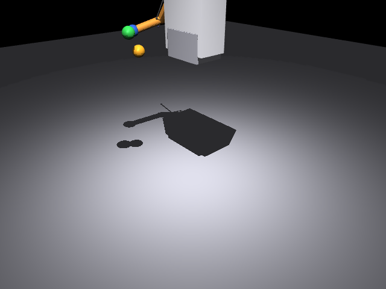
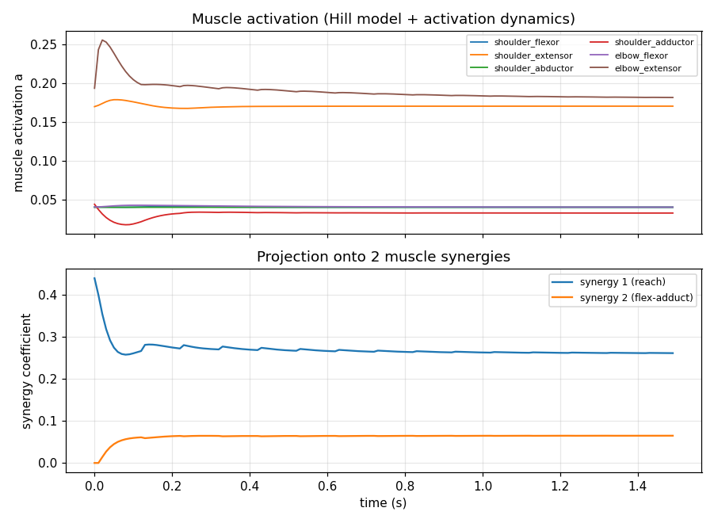

# 人形机器人肌肉驱动上肢仿真与键盘运动控制（humanoid_muscle_arm_control）

> 对应课程任务①：*对人形机器人/肌肉骨骼人/车辆/水下机器人/无人机进行物理仿真，
> 并使用键盘控制其运动。* 本模块实现其中的**肌肉驱动（肌肉骨骼式）上肢**：自建 Hill 型肌肉
> 驱动的右上肢模型，在 MuJoCo 中实时仿真，用键盘控制末端目标点，并发布关节、末端、肌肉激活与
> 肌力话题；按仓库分类归档于「人形机器人」。

与同分类的 [人形机器人键盘运动控制](./humanoid_keyboard_control.md)（关节力矩 PD 伺服）不同，
本模块的**驱动量不是关节力矩，而是 6 块肌肉的激活度**：肌肉通过空间腱跨越关节，
「肌力 → 腱长几何 → 关节力矩」的映射由模型自身给出（力矩臂实测），控制器只决定
「募集哪些肌肉、募集多少」，因此可以进一步研究**共收缩刚度**与**低维肌肉协同**。

## 1. 运行架构

```text
终端按键 ──► keyboard_teleop_node ──/cmd_vel──► humanoid_muscle_arm_control 仿真节点 ──► MuJoCo
             (raw 模式读键)        (Twist 指令)   │  目标点 → DLS 逆解 → 关节 PD
                                                  │  + qfrc_bias 重力/科氏补偿
                                                  │  → 力矩臂矩阵（实测）非负最小范数反解
                                                  │  → 6 块肌肉激活 → 空间腱肌力
                                                  └─► /joint_states · /musculoskeletal/hand_pose
                                                      /musculoskeletal/activation · /muscle_force
                                                      /tf（tf2_ros: world → musculoskeletal/hand）
```

## 2. 按键映射

| 按键 | 动作 | 指令分量 |
|---|---|---|
| `W` / `S` | 末端前伸 / 后收 | `linear.x = ±0.18` m/s |
| `A` / `D` | 末端左移 / 右移 | `linear.y = ±0.18` m/s |
| `Q` / `E` | 末端上升 / 下降 | `linear.z = ±0.18` m/s |
| `空格` | 急停（目标点保持） | 全零 |
| `R` | 目标点回位 | — |
| `ESC` | 退出 | — |
| 松开按键 | 停止 | 全零 |

## 3. 编译与运行

### 3.1 standalone（无需 ROS，最快验证）

```shell
cd src/humanoid/humanoid_muscle_arm_control
python3 main.py --check     # 模型自检：力矩臂矩阵 / 主动肌-拮抗肌配对 / 控制回路
python3 main.py             # 键盘交互控制
python3 main.py --demo      # 自动演示：初始姿态 → 前伸 → 侧向 → 前下方 → 回位
python3 main.py --test      # 自动化测试（11 项，含共收缩刚度与肌肉协同实验）
python3 main.py --capture DIR   # 生成文档素材（关键帧/动图/激活曲线/metrics.json）
python3 main.py --synergy   # 实验性：2 维肌肉协同控制（默认关闭，见 §7）
```

无显示环境（SSH / 容器）下渲染需 `export MUJOCO_GL=egl`（本模块实测在 VMware 虚拟机的 SSH 会话下
用 EGL 离屏渲染出图）。

### 3.2 ROS2 Humble launch

```shell
cd ~/ros2_ws && colcon build --symlink-install --packages-select humanoid_muscle_arm_control
source install/setup.bash
ros2 launch humanoid_muscle_arm_control main.launch.py
```

焦点保持在启动终端，按 `W/S/A/D/Q/E` 操控末端，松开即停，`ESC` 退出。
另开终端可查看状态（`/tf` 由 `tf2_ros` 广播，可用 `tf2_echo` 直接验证）：

```shell
ros2 topic echo /joint_states
ros2 topic echo /musculoskeletal/activation
ros2 topic echo /musculoskeletal/muscle_force
ros2 run tf2_ros tf2_echo world musculoskeletal/hand
```

`config/sim_params.yaml` 采用 ROS2 两段式（`/**` → `ros__parameters`），**launch 与 standalone 共用同一份参数**。

## 4. 肌肉骨骼模型

### 4.1 骨骼与肌肉（models/musculoskeletal_arm.xml）

固定躯干 + 右臂 3 个自由度（肩 pitch / 肩 roll / 肘 pitch），上臂 0.30 m、前臂 0.26 m，
肩关节位于世界坐标 `(0, −0.20, 1.40)`，末端可达半径 ≈ 0.56 m。场景内置三个目标球作为演示路标。
机器人本体几何设为 `contype/conaffinity = 0`（关闭自碰撞）：上臂正好贴在胸箱表面，
若开启碰撞会产生持续接触力把手臂顶开并诱发控制振荡（见 §6）。

| 肌肉 | 功能 | 起点 | 止点 | F_max |
|---|---|---|---|---|
| `shoulder_flexor` | 肩前屈 | 胸前 `ch_ant` | 上臂中段 `ua_mid` | 320 N |
| `shoulder_extensor` | 肩后伸 | 胸后 `ch_post` | 上臂中段 `ua_mid` | 320 N |
| `shoulder_abductor` | 肩外展 | 肩外上 `ch_lat` | 上臂近端 `ua_sh` | 200 N |
| `shoulder_adductor` | 肩内收 | 肩内下 `ch_med` | 上臂近端 `ua_sh` | 200 N |
| `elbow_flexor` | 屈肘（**跨肩肘双关节肌**） | 胸前 `ch_bi` | 前臂前侧 `fa_flex` | 220 N |
| `elbow_extensor` | 伸肘（单关节） | 上臂后侧 `ua_post` | 前臂后侧 `fa_ext` | 300 N |

**肌力矩臂由模型实测**，不手写：对每个关节角做中心差分
`M[i,j] = ∂L_i/∂q_j ≈ (L(q_j+ε) − L(q_j−ε)) / 2ε`（`ε = 1e-4 rad`），每 100 物理步刷新一次
（姿态变化后力矩臂缓慢变化）。实测矩阵（单位 m）：

| 肌肉 \ 关节 | shoulder_pitch | shoulder_roll | elbow_pitch |
|---|---|---|---|
| shoulder_flexor | **0.1072** | 0.0000 | 0.0000 |
| shoulder_extensor | **−0.0936** | 0.0000 | 0.0000 |
| shoulder_abductor | 0.0053 | **0.0414** | 0.0000 |
| shoulder_adductor | −0.0116 | **−0.0453** | 0.0000 |
| elbow_flexor | 0.0696 | 0.0000 | **0.0609** |
| elbow_extensor | −0.0000 | 0.0000 | **−0.0338** |

三个自由度都存在正/负力矩臂配对（主动肌-拮抗肌），且屈肘肌同时作用于肩与肘（双关节肌的耦合）。

### 4.2 Hill 型肌肉模型（muscle_model.py）

激活动力学（一阶，Winters/Zajac）：

\[
\dot a = (u-a)\frac{0.5+1.5a}{\tau_{act}}\ (u\ge a),\qquad
\dot a = \frac{u-a}{\tau_{deact}}\ (u<a),\qquad \tau_{act}=15\,\text{ms},\ \tau_{deact}=60\,\text{ms}
\]

力-长度（高斯主动 + 指数被动，被动力限幅避免长位形下爆炸）与力-速度（向心 Hill 双曲线 + 离心增强）：

\[
f_L=e^{-((\tilde L-1)/1.1)^2},\quad
f_{PE}=\min\!\big(0.015(e^{4(\tilde L-1)}-1),\,0.08\big),\quad
f_V=\begin{cases}\dfrac{1+\tilde v}{1-\tilde v/0.25} & \tilde v<0\\[2mm] 1+0.4(1-e^{-3\tilde v}) & \tilde v\ge 0\end{cases}
\]

\[
F = F_{max}\left(a f_L f_V + f_{PE}\right),\qquad \tilde L = L/L_{opt},\ \tilde v = v/v_{max},\ v_{max}=10L_{opt}
\]

`L_opt` 在启动时按标称姿态的腱长自动标定（实测 12~38 cm），因此改模型尺寸不需要重调曲线参数。

### 4.3 控制分配（sim_core.py）

**① 符号约定（实测标定）**：用「单块肌肉施加 50 N 恒力、关闭重力、观察关节运动」的实验确认，
MuJoCo 的 `tendon` 执行器对关节的力矩贡献为

\[
\tau_j = +M[i,j]\,F_i
\]

（实测：`shoulder_flexor` → Δq_pitch = +0.265 rad、`shoulder_extensor` → −0.224 rad，与 M 同号）。
按教科书写成 `−M` 会让分配器命令反向力矩，整条回路变成正反馈、手臂被推飞——这是本项目
最隐蔽的一个坑，只能靠真仿真实验发现。

**② 非负约束**：肌肉只能拉（`F_i ≥ 0`），而无约束最小范数解常常要求某些肌肉"推"。
直接截断会让实际力矩只有期望的 ~1/3。这里枚举激活子集（≤2⁶ 组）求解，并按**字典序**挑选：
先要求能复现期望力矩（`‖M_S^T ΔF_S − residual‖ ≤ 1e-3 N·m`），再在其中取 `‖ΔF‖²` 最小者；
若无解（真实肌肉力量饱和）则取残差最小者。

**③ 不受控力矩要扣除**：共收缩基量 `c0·F_max` 与被动弹性力 `F_max·f_PE` 都会产生关节力矩，
且因主动肌/拮抗肌力矩臂不等不能自动抵消，必须先从期望力矩里扣除，否则形成恒定偏置
（实测会带来几十毫米的稳态误差）：

\[
\Delta F = G\,(G^{T}G+\varepsilon I)^{-1}\big(\tau^{*} - M^{T}(F_{base}+F_{passive})\big),\qquad G = M
\]

**④ 控制器**：`control_mode="ik"`（默认）用阻尼最小二乘（DLS）**多起点**数值逆解求出可行关节目标，
再做关节 PD + 阻尼注入 + `qfrc_bias` 重力/科氏补偿。单起点的雅可比转置控制会卡在关节限位与
局部解上（实测"侧向"路标 IK 残差 303 mm），多起点重试后降到 0.03 mm 以内。

### 4.4 低维肌肉协同与刚度实验

* **协同分析**：对仿真记录的 6 维激活矩阵做非负矩阵分解（乘法更新法，纯 numpy），
  实测 **2 个协同解释 76.82% 的方差**（对照：手工设计的 2 协同基底解释率为负，
  说明手工基底与真实募集模式不匹配）。
* **共收缩刚度**：末端施加已知探针力（`mj_applyFT`），实测稳态位移反推刚度；
  实验期间关闭位置反馈，测的才是「肌肉共收缩 + 被动组织」刚度而不是控制器刚度。

## 5. 效果图

自动演示（初始姿态 → 前伸 → 侧向 → 前下方 → 回位，场景第三视角）：



关键帧（实测稳态误差标注在下方表格中）：

| 初始姿态 | 前伸（前伸协同） | 侧向（肩外展） | 前下方（屈肘协同） |
|---|---|---|---|
|  |  |  |  |

肌肉激活度与 2 维协同系数曲线（激活度含共收缩基量，因此静息时也不为 0）：



| 关键帧 | 末端目标 (m) | 实测末端 (m) | 稳态误差 | 稳定用时 | 主要募集肌肉（激活度） |
|---|---|---|---|---|---|
| scene_home | (0.357, −0.200, 1.061) | (0.354, −0.200, 1.058) | **3.52 mm** | 0.30 s | 肩伸 0.169、肘伸 0.179 |
| scene_forward | (0.42, −0.20, 1.14) | (0.417, −0.200, 1.136) | **5.17 mm** | 1.27 s | 肩伸 0.210、肘伸 0.168 |
| scene_lateral | (0.24, −0.44, 1.10) | (0.244, −0.438, 1.099) | **4.74 mm** | 1.47 s | 肩内收 0.184、肘伸 0.254 |
| scene_low | (0.34, −0.22, 1.00) | (0.334, −0.225, 1.004) | **5.58 mm** | 1.64 s | 肘伸 0.125、肩伸 0.169 |

## 6. 实现要点与踩坑记录

| 问题 | 现象 | 原因与修正 |
|---|---|---|
| 力矩符号 | 手臂直接飞向关节限位并顶住 | `tendon` 执行器的关节力矩是 `+MᵀF`（实测标定），按 `−MᵀF` 实现会变成正反馈 |
| 共收缩偏置 | 保持不动时仍持续漂移 | `c0·F_max` 的净力矩不为零，必须从期望力矩中扣除 |
| 被动力偏置 | 几十毫米的稳态误差 | 被动力是"不受控力矩"，作为已知扰动在分配中一并扣除 |
| 肌肉只能拉 | 实际力矩仅为期望的 ~1/3 | 改用激活子集枚举的非负最小二乘（字典序目标） |
| 自碰撞 | 手臂被"顶开"、持续振荡 | 上臂贴在胸箱表面，`contype/conaffinity=1` 产生接触力；关闭本体自碰撞 |
| 局部解/限位 | 侧向路标 IK 残差 303 mm | 单起点 DLS 卡住；改多起点重试（热启动 → 当前 → 初始 → 随机） |
| 极限环 | 抬高姿态下肘关节往复振荡 | 肌肉激活延迟（15~60 ms）+ 增益过大 ⇒ 降 `kp_joint` 并加关节阻尼注入 |
| 肘部力矩不足 | 肘跟踪普遍差 | 肘伸肌力矩臂仅 1.9 cm、容量不足；调整止点把力臂提到 3.4 cm 并提高 F_max |

## 7. 性能评价与已知限制

自动化测试（`python3 main.py --test`，11 项全部通过；Ubuntu 22.04.5 + MuJoCo 3.15.0，
2 vCPU 虚拟机、SSH 会话下 `MUJOCO_GL=egl` 离屏渲染）实测：

| 指标 | 结果 |
|---|---|
| 力矩臂矩阵 | 3 个自由度均存在主动肌/拮抗肌配对；最大力矩臂 10.72 cm（肩 pitch） |
| 控制分配恒等式 | 未饱和情形最大复现误差 **0.000 mN·m** |
| 激活动力学 | 上升到 63% 用时 **15.0 ms**，放松到 37% 用时 **59.0 ms** |
| 末端定位精度 | 前伸 **2.95 mm** / 侧向 **2.73 mm** / 前下方 **3.01 mm**（稳态） |
| 重力/科氏补偿 | 开启 **1.53 mm** vs 关闭 **140.42 mm**（提升 138.89 mm） |
| 共收缩刚度 | c0=0.02 → **197.4 N/m**；c0=0.50 → **216.1 N/m**（提升 1.09 倍） |
| 肌肉协同 | NMF(2) 方差解释率 **76.82%**（450 帧 × 6 块肌肉） |
| 相机渲染 | 640×480 RGB（EGL 离屏） |
| 仿真吞吐 | **2520 step/s**（实时因子 **2.52×**，含每步力矩臂刷新与非负分配枚举） |

**已知限制（如实记录）**

1. **抬高位形能力不足**：把目标点抬到肩高以上（如 `(0.30, −0.20, 1.50)`）时稳态误差约 250 mm，
   因为这条简化手臂在抬高位形需要的肌力矩超出当前肌肉容量与力矩臂的组合；
   演示路标因此选在实测能稳定跟踪的低负载位形。
2. **2 维协同控制模式不可用**（`--synergy`，默认关闭）：手工协同基底不足以覆盖所需的肌肉募集模式，
   实测跟踪误差 557~708 mm；**协同分析（NMF 76.82%）有效**，协同控制留作后续工作。
3. **共收缩对刚度影响有限**（+9%）：本模型的被动刚度与重力主导，需更大共收缩或加入反射控制才明显。
4. 模型是 3 自由度上肢（无腕、无手、无接触任务），不等同于完整肌肉骨骼人。

## 8. 参考

* [人形机器人键盘运动控制](./humanoid_keyboard_control.md)：同分类模块（关节力矩 PD 路线）对照
* [水下机器人物理仿真与 6-DOF 键盘运动控制](../water/rov_physical_simulation.md)：本包 ROS2 结构惯例参考
* [MuJoCo 文档：spatial tendon / mj_jacSite / mj_applyFT](https://mujoco.readthedocs.io/en/stable/XMLreference.html)
* Winters J. M., *An improved muscle-reflex actuator for use in large-scale neuromusculoskeletal models*, 1995
* d'Avella A. et al., *Combinations of muscle synergies in the construction of a natural motor behavior*, Nature Neuroscience, 2003

---

**AI 使用声明**：模型几何、Hill 肌肉模型、力矩臂标定、非负控制分配、DLS 逆解、协同分析与刚度实验
均为本作业实现；代码与文档在 AI 助手协助下完成，文中所有实测数字均由 `main.py --test` /
`main.py --capture` 在本机 Ubuntu 22.04 + MuJoCo 3.15.0 环境中运行产生。
